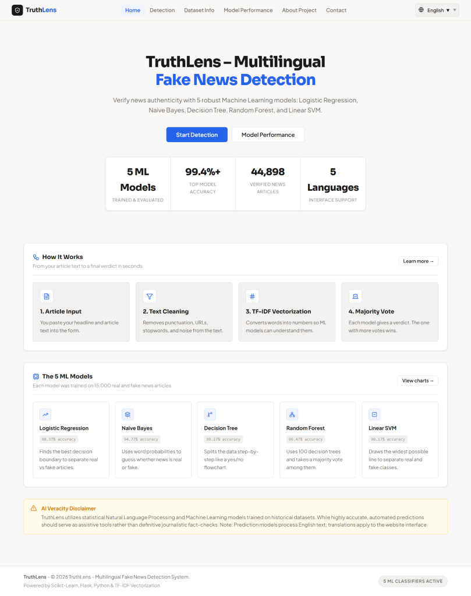

<div align="center">

  

  <br/>
  <br/>

  [](https://truthlens-delta-one.vercel.app)
  [](https://python.org)
  [](https://flask.palletsprojects.com)
  [](https://scikit-learn.org)
  [](LICENSE)

</div>

---

## What is TruthLens?

**TruthLens** is a web application that evaluates news articles using **5 Machine Learning models**. Enter any news headline or body text to inspect predictions from each classifier, complete with confidence scores and a majority voting consensus.

---

## Live Preview

<div align="center">
  <a href="https://truthlens-delta-one.vercel.app">
    
  </a>
  <br/>
  <sub>Click the image to visit the live site</sub>
</div>

---

## Features

- **5 ML Classifiers**: Runs Logistic Regression, Naive Bayes, Decision Tree, Random Forest, and Linear SVM concurrently
- **Ensemble Consensus**: Aggregates individual model outcomes using majority voting
- **Confidence Metrics**: Displays individual probabilistic prediction confidence per model
- **Multilingual Interface**: Localized in 5 languages (English, Tamil, Hindi, Telugu, Kannada)
- **Responsive Layout**: Minimal, clean design built with Plus Jakarta Sans and Sora typography
- **Zero-Latency Inferences**: Pre-trained and serialized via Joblib for instant inference on Vercel

---

## Model Accuracy

| # | Model | Accuracy | F1 Score |
|---|-------|----------|----------|
| 1 | Random Forest | **99.47%** | 99.51% |
| 2 | Decision Tree | **99.27%** | 99.32% |
| 3 | Linear SVM | **99.17%** | 99.23% |
| 4 | Logistic Regression | **98.37%** | 98.51% |
| 5 | Naive Bayes | **94.77%** | 95.16% |

> Models trained on 15,000 balanced samples from the [Fake and Real News Dataset](https://huggingface.co/datasets/genesisqu/fake-real-news).

---

## How It Works

```
Article Text
    ↓
Text Cleaning  →  lowercase, URL stripping, punctuation & stopword removal
    ↓
TF-IDF         →  5,000-dimensional term frequency feature extraction
    ↓
5 ML Models    →  concurrent classification into Real or Fake
    ↓
Majority Vote  →  consensus based on 3+ matching model predictions
```

---

## Tech Stack

| Component | Technology |
|---|---|
| **Backend** | Python 3, Flask |
| **Machine Learning** | Scikit-Learn, Joblib, TF-IDF Vectorizer |
| **Frontend** | HTML5, CSS3, JavaScript, Lucide SVG Icons |
| **Data Visualizations** | Chart.js |
| **Typography** | Sora + Plus Jakarta Sans |
| **Deployment** | Vercel (Production) |

---

## Run Locally

```bash
# 1. Clone the repository
git clone https://github.com/KEVINLOURDU/TruthLens.git
cd TruthLens

# 2. Install dependencies
pip install -r requirements.txt

# 3. Start the Flask server
python app.py

# 4. Open http://localhost:5000 in your browser
```

---

## Pages

| Page | Description |
|---|---|
| **Home** | System overview, pipeline breakdown, and quick statistics |
| **Detection** | Live news verification workspace with real-time inference |
| **Dataset Info** | Dataset distribution, preprocessing stages, and sample records |
| **Model Performance** | Accuracy charts, recall, precision, and confusion matrices |
| **About** | Research methodology, mathematical definitions, and technical docs |
| **Contact** | Project contact and feedback form |

---

## Multilingual UI

Switch the interface language using the selector in the top-right corner:

`English` &nbsp;•&nbsp; `Tamil (தமிழ்)` &nbsp;•&nbsp; `Hindi (हिन्दी)` &nbsp;•&nbsp; `Telugu (తెలుగు)` &nbsp;•&nbsp; `Kannada (ಕನ್ನಡ)`

---

## Author

**Kevin Lourdu**

[](https://github.com/KEVINLOURDU)
[](https://truthlens-delta-one.vercel.app)
